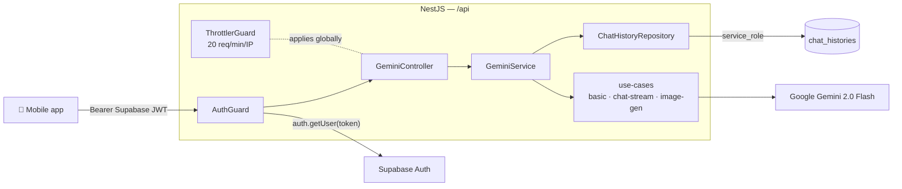

<div align="center">

# Gemini Backend — VoluntariadoUPB

**Secure NestJS proxy to Google Gemini.**
Verifies Supabase JWTs, streams responses, and persists chat history with application-level ownership enforcement.

[](https://nestjs.com)
[](https://www.typescriptlang.org/)
[](https://ai.google.dev)
[](https://supabase.com)
[]()

</div>

---

## Why does this backend exist?

Calling Google Gemini directly from the mobile app would cause two problems:

1. **API key leakage.** Any `EXPO_PUBLIC_*` value ends up in the JS bundle and is trivial to extract.
2. **No quota control.** A single user could burn the project's credit in seconds.

This service adds an intermediary layer that:

- Validates the **Supabase JWT** on every request.
- **Rate-limits** to 20 req/min per IP.
- **Persists** chat history in Postgres with application-level ownership (because the `service_role` key bypasses RLS — see Security section).
- Streams real responses (`AsyncGenerator`) from the model to the client.

---

## Architecture



### Endpoints

| Method | Route | Description |
| --- | --- | --- |
| `GET`    | `/api`                             | Health check (anonymous) |
| `POST`   | `/api/gemini/basic-prompt`         | Single prompt, JSON response |
| `POST`   | `/api/gemini/basic-prompt-stream`  | Single prompt, streaming |
| `POST`   | `/api/gemini/chat-stream`          | Chat with persisted history, streaming |
| `GET`    | `/api/gemini/chat-history/:chatId` | Read history for **the authenticated user** |
| `DELETE` | `/api/gemini/chat-history/:chatId` | Clear history for **the authenticated user** |
| `POST`   | `/api/gemini/image-generation`     | Generate an image and upload to Supabase Storage |

All routes under `/api/gemini/*` require the header:
`Authorization: Bearer <supabase_access_token>`.

---

## Security

### Ownership enforcement in `chat_histories`

The backend uses Supabase's **service_role** key, which **bypasses RLS**. The policies on `chat_histories` (`auth.uid() = user_id`) protect direct client access but **not** this service-role pathway.

Ownership is therefore enforced in code:

- `findByChatId(chatId, userId)` filters by both columns. Returns `[]` if the chat doesn't exist **or** belongs to another user — without revealing which.
- `checkOwnership(chatId, userId)` returns `owned | new | forbidden`. Called before any `save` or `clear` to prevent a guessed `chat_id` from overwriting another user's history.
- `clear(chatId, userId)` filters the `DELETE` by both columns — a non-matching filter is a silent no-op.

> See tests in [`src/gemini/repositories/chat-history.repository.spec.ts`](src/gemini/repositories/chat-history.repository.spec.ts)
> and [`src/gemini/gemini.service.spec.ts`](src/gemini/gemini.service.spec.ts).

### Other protections

- `ValidationPipe({ whitelist: true, forbidNonWhitelisted: true })` rejects unknown fields on every DTO.
- CORS restricted by `CORS_ORIGINS` env var (never `enableCors()` with no args).
- Env var validation at startup (class-validator) — the server won't boot if a required key is missing.

---

## Setup

### Requirements

- **Node.js** ≥ 20
- A **Supabase** project with the `service_role` key available
- A **Google Gemini** API key (https://aistudio.google.com/apikey)

### 1. Environment variables

Copy [`.env.example`](.env.example) to `.env`:

```bash
GEMINI_API_KEY=...                        # https://aistudio.google.com/apikey
SUPABASE_URL=https://<project>.supabase.co
SUPABASE_SERVICE_ROLE_KEY=eyJ...          # ⚠️  never expose to the frontend
PORT=3000                                 # optional, default 3000
CORS_ORIGINS=http://localhost:4000,http://localhost:8081,http://localhost:19006
```

### 2. Apply the database schema

```bash
# Run the full file in the Supabase SQL editor:
sql/schema.sql
```

The schema creates: `chat_histories`, `users`, `oportunidades`, `postulaciones`,
`ubicaciones`, `pg_trgm` indexes, `updated_at` triggers, RLS, and the
`handle_new_user` function that syncs `auth.users` ↔ `public.users`.

### 3. (Optional) Seed test users

```bash
npx ts-node seed.ts
```

Creates 3 auth users with fixed UUIDs and their rows in `public.users`. Auth users **must** be created via GoTrue — not raw SQL — so that passwords are correctly hashed.

### 4. Run

```bash
npm install
npm run start:dev        # watch mode on http://localhost:3000
```

Other scripts:

```bash
npm run build            # compile to dist/
npm run start:prod       # node dist/main
npm run lint             # eslint --fix
npm test                 # Jest unit tests
npm run test:cov         # with coverage
npm run test:e2e         # end-to-end tests
```

Run a single test:

```bash
npx jest src/auth/auth.guard.spec.ts
npx jest -t "blocks streaming when the user does not own"
```

---

## Project structure

```
gemini-backend/
├── src/
│   ├── auth/
│   │   ├── auth.guard.ts           # Verifies Supabase JWT
│   │   └── auth.guard.spec.ts
│   ├── config/env.validation.ts    # class-validator at startup
│   ├── gemini/
│   │   ├── gemini.controller.ts    # HTTP endpoints
│   │   ├── gemini.service.ts       # Orchestrates use-cases + ownership
│   │   ├── gemini.module.ts
│   │   ├── dtos/                   # DTOs (class-validator)
│   │   ├── helpers/                # Sharp / Gemini File API upload
│   │   ├── repositories/
│   │   │   └── chat-history.repository.ts   # Supabase persistence
│   │   └── use-cases/              # One file per use case
│   ├── health/health.controller.ts
│   ├── supabase/                   # service_role client
│   ├── app.module.ts
│   └── main.ts                     # Bootstrap + CORS + Throttler
├── sql/schema.sql                  # Full schema (idempotent)
├── seed.ts / seed.sql
└── package.json
```

### Patterns

- **1 use-case = 1 file.** `gemini.service.ts` delegates; it contains no prompt logic.
- DTOs with `class-validator`; the global `ValidationPipe` rejects unknown fields.
- Streaming = `AsyncGenerator<GenerateContentResponse>` → `res.write()` per chunk.
- Errors caught in the controller via `handleStreamError` (after `res.headersSent`, writes `\n[Error] …` in the body to avoid breaking the client).

---

## Tests

| Suite | Coverage |
| --- | --- |
| `auth.guard.spec.ts` | No header, malformed header, invalid token, happy path |
| `chat-history.repository.spec.ts` | `user_id` filters, `owned/new/forbidden` semantics |
| `gemini.service.spec.ts` | Cross-user block for `chatStream` / `saveMessages` / `clearChatHistory` |

```
Test Suites: 3 passed
Tests:       17 passed
```

---

## Deployment

> No CI/CD pipeline is configured yet — see [`../GUIA_MEJORAS_MANUALES.md`](../GUIA_MEJORAS_MANUALES.md) for manual deployment steps and the GitHub Actions roadmap.

Production runtime requirements:

- Node 20+
- `CORS_ORIGINS` set to the client domain(s)
- `SUPABASE_SERVICE_ROLE_KEY` in runtime environment variables only, **never** in the repo

---

## License

Private. Academic project for Universidad Privada Boliviana.
